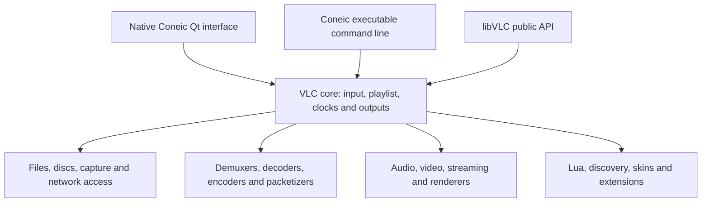

# Architecture and scope

Coneic builds VLC's native Windows executable, Qt interface, libVLC, core and plugins. It does not wrap another installed VLC executable, and it does not replace VLC with browser media APIs.

The baseline has 1,901 module source files and 479 module registrations. Original menus, action handlers, dialog implementations, shortcuts, option declarations and API identifiers are preserved. The source audit compares exact baseline blobs, declarations and selected workflow files; it is not a semantic proof of every path.

Presentation changes live in the Qt theme/header, startup branding/resources and main-window title/size. Windows executable resources and app-data names are changed for Coneic. The separate `%APPDATA%/coneic` settings directory avoids sharing the upstream player's settings. Internal `vlc` module/domain/API names remain compatible.

The logo is a supplied SVG with embedded raster layers. Exact copies and mechanical PNG/ICO exports are included. Resources map both ordinary and seasonal application-icon aliases to the supplied artwork. Existing specialized preferences/toolbar illustrations and original credits remain upstream.

The portable application retains advanced workflows and an unmodified ActiveX baseline DLL. Installation-time registration, file associations and shell integration are separate from portable desktop behavior.
